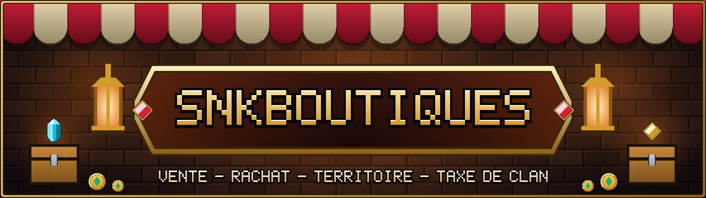
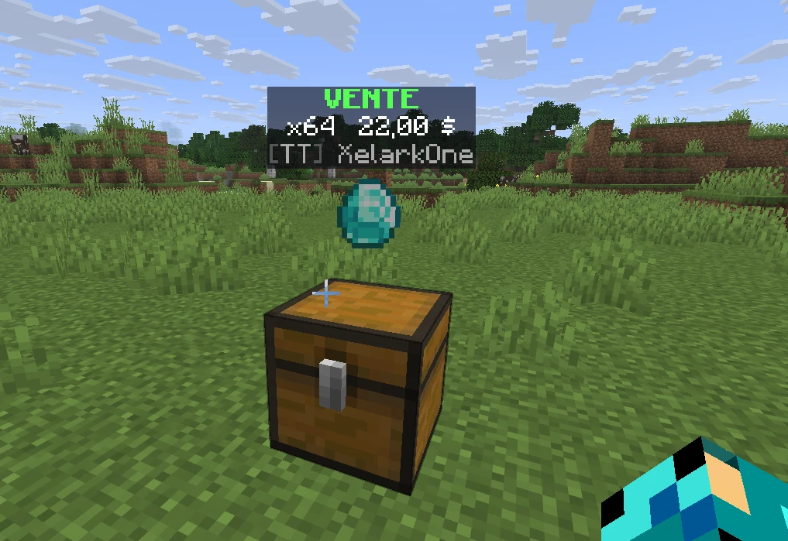
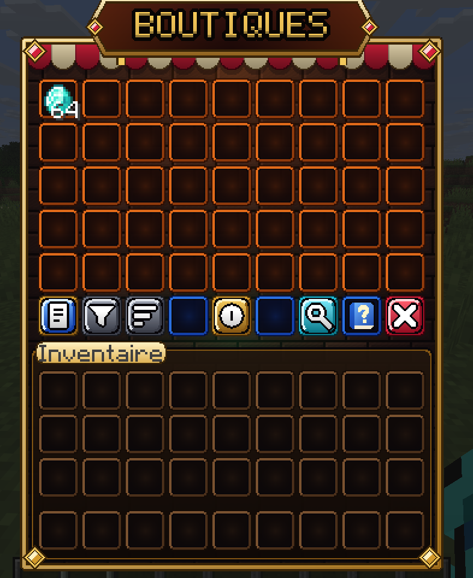

<b>Les joueurs ouvrent leurs boutiques avec de vrais coffres, dans le territoire de leur clan.</b> 
Plugin Minecraft pour serveurs <b>Paper 1.21.4 à 26.3</b>, par <b>SnkAlex</b>.

<a href="#-fonctions">Fonctions</a> •
<a href="#-captures">Captures</a> •
<a href="#-créer-une-boutique">Créer une boutique</a> •
<a href="#-commandes">Commandes</a> •
<a href="#-compatibilité">Compatibilité</a> •
<a href="#-lobtenir">L'obtenir</a>

---

## ✨ Fonctions

### 📦 De vrais coffres
- Un coffre ou un tonneau devient une boutique : **le stock est dedans**
- L'objet et le prix **flottent au-dessus**, avec le clan et le propriétaire
- **Vente** (« je vends ») ou **rachat** (« je rachète »), à l'unité ou par lots
- Le propriétaire est payé **même déconnecté**, et prévenu à son retour

### 🚩 Liées aux clans
- Les boutiques se créent dans le **territoire du clan** (réglable)
- Une **permission de grade** choisit qui peut en créer
- Les recrues vendent pour le clan ; les autres choisissent : **pour soi, pour le clan ou moitié-moitié**

### 💰 La taxe
- Une part de chaque vente va à la **banque du clan** : le chef choisit le pourcentage
- Une autre petite part disparaît, pour que les prix du serveur ne s'envolent pas

### 🧭 Trouver et rejoindre une boutique
- `/boutique` : toutes les boutiques ouvertes, avec recherche par objet, joueur ou clan, et tri par prix ou distance
- **Clan ou allié :** téléportation gratuite
- **Clan neutre :** téléportation payante, retour compris, ou à pied
- **Ennemi :** à pied seulement
- Une **flèche et la distance** guident ceux qui marchent
- **Protection à l'arrivée** et endroit vérifié : pas de piège dans la lave

### 🛡️ Protégées
Contre la casse, les explosions, le feu, les entonnoirs et les doubles coffres. Les échanges sont faits pour qu'aucun objet ne soit dupliqué ou perdu.

### 🎨 Des menus dessinés
Les menus ont leur propre interface grâce à un pack de ressources fourni. Les joueurs qui n'ont pas le pack voient des menus classiques.

---

## 📸 Captures

 Une boutique : l'objet et le prix flottent au-dessus du coffre

 La liste des boutiques du serveur

---

## 🛠️ Créer une boutique

1. Poser un coffre simple ou un tonneau **vide** dans le territoire de son clan
2. Tenir l'objet en main, regarder le coffre et taper `/boutique creer`
3. Choisir vente ou rachat, le prix, la taille du lot et où va l'argent
4. Clic droit sur le coffre pour le remplir

Maj + clic droit pour la régler ou la supprimer.

---

## ⌨️ Commandes

| Commande | Effet |
|---|---|
| `/boutique` (ou `/boutiques`) | Toutes les boutiques ouvertes |
| `/boutique creer` | Crée une boutique |
| `/boutique mes` | Ses boutiques |
| `/boutique chercher <mot>` | Cherche un objet, un joueur ou un clan |
| `/boutique retour` | Revient après une téléportation |
| `/boutique stop` | Arrête la boussole |
| `/boutique taxe [pourcentage]` | Voir la taxe du clan, ou la changer (chef) |
| `/boutique reload` | Recharge les réglages (admin) |

**Permissions :** `snkboutiques.creer` (créer), `snkboutiques.admin` (admin).

---

## 🧩 Compatibilité

| | |
|---|---|
| **Versions** | 1.21.4 à 26.3, un seul fichier pour toutes |
| **Testé sur** | Paper 1.21.4, 1.21.11, 26.2 et 26.3 |
| **Serveur** | Paper |
| **Java** | 21 ou plus (celui de ta version de Paper) |
| **Obligatoire** | [SnkClans](https://github.com/SnkStudio/SnkClans) 1.4.0 ou plus, Vault et une économie |
| **Sauvegarde** | SQLite, en arrière-plan, rien à installer |

**Va plus loin avec les autres plugins Snk** (facultatifs) :
- **[SnkMarche](https://github.com/SnkStudio/SnkMarche)** : boutique du serveur, promos et hôtel des ventes
- **[SnkMetiers](https://github.com/SnkStudio/SnkMetiers)** : 6 métiers et la monnaie du serveur
- **[SnkGemmes](https://github.com/SnkStudio/SnkGemmes)** : 21 outils en émeraude, rubis et saphir

---

## 📦 Ce que tu reçois
- Le plugin (`.jar`)
- Le pack de ressources des menus
- Le guide d'installation et le guide complet, en français

Aucune connaissance en code n'est nécessaire : tout se règle dans un fichier.

---

## 📩 L'obtenir

Le plugin n'est pas en téléchargement libre. Pour le prix, une question ou une démonstration :

➡️ **[Écris-moi ici](../../issues/new/choose)** (il faut un compte GitHub, c'est gratuit)

> Les messages sont **publics** : n'écris ni adresse e-mail, ni mot de passe, ni information de paiement. On passe ensuite en privé.

---

© SnkAlex. Tous droits réservés. Voir <a href="LICENSE.md">la licence</a>. 
Ce plugin n'est pas un produit officiel Minecraft. Il n'est ni approuvé par Mojang ou Microsoft, ni associé à eux.

